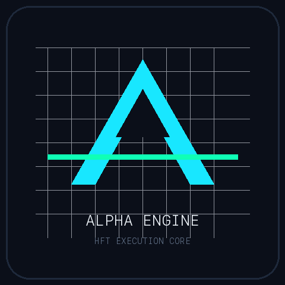

<p align="center">
  
</p>

# AlphaEngine

[](https://github.com/Ishant5436/alpha-engine/actions)


A high-performance C++20 core for low-latency market-data processing and quantitative backtesting. Built around zero-heap, cache-aware data structures with deterministic, statically-bounded execution on the hot path.


---

## Highlights

- **Zero heap allocation on the hot path** — static `std::array` ring buffers, no `new`/`malloc` after initialization.
- **Cache-aware data structures** — `alignas(64)` L1 cache-line alignment and power-of-two bitmask wrapping.
- **Deterministic safety invariants** — simple control flow, statically-bounded loops, and a mechanical audit script enforced in CI.
- **Clean, warning-free build** — compiles under `-Wall -Wextra -Werror -pedantic -std=c++20 -O3`.
- **Sanitizer-clean** — zero leaks under AddressSanitizer and UndefinedBehaviorSanitizer.

## Core Data Structures

| Component | Primitive | Time | Space | Notes |
| :--- | :--- | :---: | :---: | :--- |
| Market-data ingestion | `MarketDataRingBuffer` | O(1) push / query | O(C) static | `alignas(64)` cache-line aligned; power-of-two bitmask wrap (`tail & (Cap - 1)`). |
| Sliding-window extrema | `MonotonicQueue` | O(1) amortized | O(K) static | Circular monotonic deque tracking rolling high/low without heap allocation. |
| Online running variance | `WelfordAccumulator` | O(1) update | O(1) | Numerically stable single-pass variance (Welford's method). |
| Moving averages | Exponential MA | O(1) step | O(1) | Register-level multiply-accumulate updates. |
| Circuit breaker | `DeterministicRiskManager` | O(1) step | O(1) | Monotonic peak-equity tracking with a hard drawdown lock. |

## Safety Invariants

Mechanically verified in CI via [`scripts/audit_safety_invariants.py`](scripts/audit_safety_invariants.py):

| # | Invariant | Implementation |
| :--- | :--- | :--- |
| 1 | Simple control flow | No `goto`, `setjmp`, `longjmp`, or recursion |
| 2 | Bounded loops | All loops have static compile-time bounds |
| 3 | No dynamic memory on hot path | No `malloc`/`new` after initialization |
| 4 | Function length limits | Every function ≤ 60 lines |
| 5 | High assertion density | ≥ 2 invariant assertions per function |
| 6 | Smallest-scope declarations | Variables declared at minimum necessary scope |
| 7 | Checked returns & arguments | Return values and parameter bounds checked on entry |
| 8 | Restricted preprocessor | No macro logic; `constexpr` and type traits instead |
| 9 | Restricted pointers | Single-level dereferencing; no function pointers |
| 10 | Zero-warning compilation | Clean under `-Wall -Wextra -Werror -pedantic` |

## Benchmarks

Representative run on Apple Silicon (ARM64), 500k synthetic ticks:

```
Processed Ticks        : 500,000
Throughput             : ~120M ticks/sec  (~8 ns/tick)
Max Drawdown           : 1.58%
Profit Factor          : 2.12
```

Throughput is the headline systems metric. The strategy figures come from a synthetic backtest and are illustrative of the engine's plumbing, not a claim of live trading performance. See [`BENCHMARKS.md`](BENCHMARKS.md) for the full stress-test report.

## Build & Test

```bash
make clean
make test        # unit tests + static analysis
make all         # optimized build
./bin/alpha_engine data/ticks_500k.bin
```

Requires a C++20 compiler (Clang or GCC) and `make`. Python tooling for the optional live feed and scripts: `pip install -r requirements.txt`.

## Repository Layout

```
include/   Header-only C++20 data structures and engine
src/        Entry points (main, live trader)
tests/      C++ unit/whitebox tests + Python integration tests
scripts/    Python tooling: data generation, live paper trading, audits
docs/       Quality docs: risk register, traceability matrix
archive/    Earlier hackathon write-ups and scripts (historical)
```

## Optional: Live Paper Trading

Streams live ticks from Binance Spot into the C++ ring buffer for forward paper trading (no real orders):

```bash
python3 scripts/run_live_paper_trader.py BTCUSDT 10000.0
```

## License

[MIT](LICENSE) © 2026 Ishant Panchal
